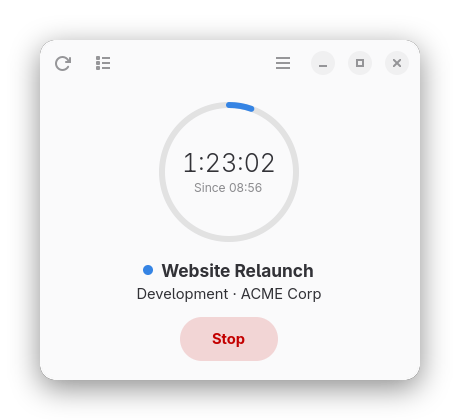

# Stempeluhr for macOS

A tiny **menu-bar time clock** for [Kimai](https://www.kimai.org/). It lives in
your menu bar, shows the running timer, and clocks you in and out with one
click — a quiet way to start and stop Kimai time tracking without opening the
web app.

<p align="center"></p>

## Features

- A **stopwatch** in the menu bar, with the ticking `H:MM` while a timer runs.
- Click it for a small panel with:
  - the live elapsed time (computed from the server's `begin`, not counted up
    locally), the project · activity, and a big **Start / Stop** button;
  - **totals** for **today** and **this week**, ticking up live;
  - **Quick start** — up to four buttons for your most recently used
    project · activity combinations, each tinted with the project's Kimai
    colour; one click starts that combo.
- **Kimai is the single source of truth.** The panel shows only what the server
  last confirmed; when it can't be reached, the last state is shown and marked
  *"Not confirmed."* Writes are never retried — after an uncertain failure the
  server is asked what happened instead.
- The API token is stored in the **macOS Keychain**, never in preferences or
  logs.

## Install (for coworkers — no build needed)

1. Go to the [**Releases**](../../releases/latest) page and download
   **`Stempeluhr-macOS.zip`**.
2. Unzip it and move **`Stempeluhr.app`** into your **Applications** folder.
3. The app isn't Apple-notarized, so the **first** launch needs one step:
   **right-click the app → Open → Open**.
   *(Equivalent one-liner: `xattr -dr com.apple.quarantine /Applications/Stempeluhr.app`.)*
4. A stopwatch appears in your menu bar. Click it, enter your Kimai server
   (`https://kimai.example.com`) and an **API token**, then **Connect**.

### Getting an API token

In Kimai: **profile → API → create token** (Kimai 2.x). Paste it with the
server address into the connect panel; the connection is tested before anything
is saved.

### Start it at login (optional)

**System Settings → General → Login Items → +** and add `Stempeluhr.app`.

## Requirements

- macOS 13 (Ventura) or newer.

## Build from source

Needs Xcode / the Swift 5.9+ toolchain.

```sh
./scripts/build-app.sh          # builds build/Stempeluhr.app (ad-hoc signed)
open build/Stempeluhr.app
```

Or open `Package.swift` directly in Xcode.

### Try it without a Kimai server

```sh
python3 tools/mock-kimai.py     # http://127.0.0.1:8765, token: testtoken
```

Connect the app to `http://127.0.0.1:8765` with token `testtoken`.

### Headless self-test

The binary can run an end-to-end check of the Kimai client (connect → list →
start → stop → totals) against a running server:

```sh
swift build
.build/debug/Stempeluhr selftest http://127.0.0.1:8765 testtoken
```

This is also run in CI on every release build.

## Cutting a release

Each release attaches a universal (Apple Silicon + Intel) `Stempeluhr-macOS.zip`
to a GitHub Release. There are two ways to produce it:

**From your Mac (works on a private repo):**

```sh
scripts/release.sh v1.0.1
```

This builds the app, zips it, pushes the tag, and creates/updates the Release
with `gh`.

**On GitHub Actions** ([`.github/workflows/release.yml`](.github/workflows/release.yml)):
pushing a `v*` tag builds on a macOS runner, runs the self-test, and publishes
the Release automatically.

> **Note:** GitHub's macOS-hosted runners are free only on **public**
> repositories. While this repo is **private**, the Actions build is refused
> ("configuration … not supported") until you either make the repo public or
> enable macOS-runner billing (Settings → Billing → spending limit). Until
> then, use `scripts/release.sh` above — it builds locally and needs no CI.

## Credits & licence

A native macOS port of the quiet core of
[**Importantus/stempeluhr**](https://github.com/Importantus/stempeluhr) — a
GNOME Kimai time clock by Fischer. The Kimai client, state machine, and
"server is the source of truth" design follow that project.

Licensed under **GPL-3.0-or-later**, like the original. See [`LICENSE`](LICENSE).
